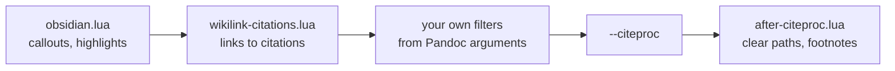

# Architecture

Due Credit turns a note into pandoc's input, runs pandoc, and writes the file
you chose. It also writes citations, at the cursor, from the bibliography. It
writes nothing else in the vault and talks to nothing but pandoc, except to
download the built-in pandoc, once, when there's none installed.

## Layers

Every decision about a note, its citations and pandoc's command line is in
[obsidian-citation-core](https://codeberg.org/BW20/obsidian-citation-core), a
library Due Credit shares with its sibling plugins and bundles into `main.js`.
What is left here is Due Credit's own: its settings, and wiring the core to
Obsidian.

| Path | What it holds |
| --- | --- |
| `src/core/settings.ts` | The settings shape, defaults and loading. Pure, with a test named after it. |
| `src/commands/export.ts` | The export: checks the settings, picks the pandoc (asking before downloading the built-in one), reads the note, asks where to save, runs pandoc, reports back. |
| `src/commands/cite.ts` | Insert citation, Add page to citation and Toggle author in citation: the bibliography's works, read again only when the file changed, and the paper's note to link to. |
| `src/ui/` | The confirmation dialog, the settings tab, the citation picker (`citation-picker.ts`) and the page question (`prompt.ts`). |
| `src/context.ts` | What a command gets from the plugin: the app, the settings and a way to save them, and nothing else. |
| `src/main.ts` | Registers the seven commands and the file menu items. |
| `src/modules.d.ts` | What esbuild bundles from the core, and the part of Electron used here. |

### The core

These paths are in the core's repository, not this one.

| In the core | What it decides |
| --- | --- |
| `src/core/prepare.ts` | Every step from a note to pandoc's input, in order. See [Pipeline](https://codeberg.org/BW20/obsidian-citation-core/src/branch/main/docs/pipeline.md). |
| `src/core/markdown.ts` | The individual rewrites: comments, tags, block IDs, footnotes, headings, images, links to paper notes. |
| `src/core/citations.ts` | Reading a `.bib`'s keys, a link's key, which links are about to lose their citation, and whether the papers folder and the key property match any note. |
| `src/core/bibliography.ts` | A `.bib`'s works as the picker shows them: key, names, year and title. |
| `src/core/writing.ts` | Writing a citation, and a page into one, with the locator words held to the filter's. |
| `src/core/document.ts` | The document's metadata, pandoc's arguments for each format, and which arguments of yours are refused. |
| `src/core/paths.ts` | Settings paths, `~`, where a citation style is, what to say when a file isn't there, and whether a path is inside the vault. |
| `src/core/built-in.ts` | Which pandoc runs (`choosePandoc`), the built-in one's version and hashes (`BUILT_IN`), its cache folder, and the paths it sees (`Mounts`, `seen`, `seenArgs`). |
| `src/pandoc.ts` | Running pandoc, installed or built-in through WASI, and writing its files to a temporary folder. |
| `src/wasm.ts` | The built-in pandoc on disk: loading it, checked against its hash, downloading it, and `pandocFor`. |
| `pandoc/` | The Lua filters. |
| `fonts/` | Open Sans, for PDF. |

**Every decision belongs in the core.** `commands/` and `ui/` wire it to
Obsidian and decide nothing.

## An export, from start to finish

1. **Check the settings.** The bibliography, Word template and citation style
   have to exist; a PDF needs an installed pandoc. Then the pandoc is chosen
   (the core's `pandocFor`, which asks before downloading the built-in one),
   since your pandoc arguments can't include a refused one, or a word pandoc
   would read as a file (`--dump-args`, asked of that pandoc). Each failure is
   a sentence saying what to do.
2. **Read the note**, from the editor when it's open, because the file can be a
   moment behind what you just typed.
3. **Prepare it** with `prepare`: the note as pandoc's markdown, its metadata,
   and the links about to lose their citation.
4. **Confirm** the lost citations, if there are any.
5. **Ask where to save**, with Electron's save dialog (through `remote`, as
   Obsidian's own PDF export does), and refuse a path inside the vault, by real
   path, so a symlink can't get around it.
6. **Run pandoc**, with every path as that pandoc sees it (`seen`,
   `seenArgs`), from a temporary folder holding the filters, the Markdown
   template, the font and the metadata. The folder is removed afterwards.
7. **Report** where the file went, with Open and Show in folder, and pandoc's
   warnings if there were any.

## How pandoc is run

The note goes in on stdin, or as a file for the built-in pandoc, and its
metadata in a file of its own. Pandoc reads a
block between `---` lines as metadata wherever it is, and in a note that is text
Obsidian shows.

Filters and citeproc run in the order they are given:

- `obsidian.lua` handles Obsidian syntax that needs pandoc's reading of the note
  and has nothing to do with citations.
- `wikilink-citations.lua` has to run before citeproc, which can only cite what
  it has already made.
- Your own arguments come after Due Credit's, so an option of yours wins over
  its default, and before citeproc, so a filter like pandoc-crossref runs where
  it has to. A `--filter` needs an installed pandoc; a `--lua-filter` works
  with either.
- `after-citeproc.lua` clears the bibliography's and style's paths, which the
  Word writer would otherwise keep as properties, user name and all. Under a
  footnote style it also finishes footnotes. See
  [Citations](citations.md#footnote-styles).

LaTeX skips citeproc and keeps `\cite` commands instead.

The built-in pandoc runs inside Obsidian, through Node's WASI. It sees the
vault as `/`, and each other folder a file it needs is in as `/.pandoc-<n>`,
with `/` between folders and `:` between the resource path's; nothing else on
the disk. It runs no other program, so no PDF engine and no `--filter`, and
fetches nothing over the network, so an image on the web is left out.

## Bundled files

A plugin ships as one `main.js`, and pandoc takes filters, templates and fonts
as paths. So esbuild bundles the core's `.lua` files as text and its `.ttf`
files as bytes (the `loader` in `esbuild.config.mjs`), and `withFiles` in the
core's `src/pandoc.ts` writes them to a fresh temporary folder for each
export.

Open Sans is bundled because few machines have it, and xelatex stops at a font
it can't find. A `mainfont` of your own replaces it.

The built-in pandoc isn't bundled: it is 62 MB, downloaded once when someone
without pandoc agrees, by the core's `src/wasm.ts`, and pinned by hash in its
`core/built-in.ts`.

## Two rules that are written twice

- **What is a citation:** in `wikilink-citations.lua`, and in
  `core/citations.ts` for the check. One table of cases in
  `tests/pandoc.test.ts` runs through both.
- **Whether a style uses footnotes:** `noteStyle` in `core/document.ts`, and
  `note_style` in `after-citeproc.lua`.

Both are in the core. Change one side and the other follows.
